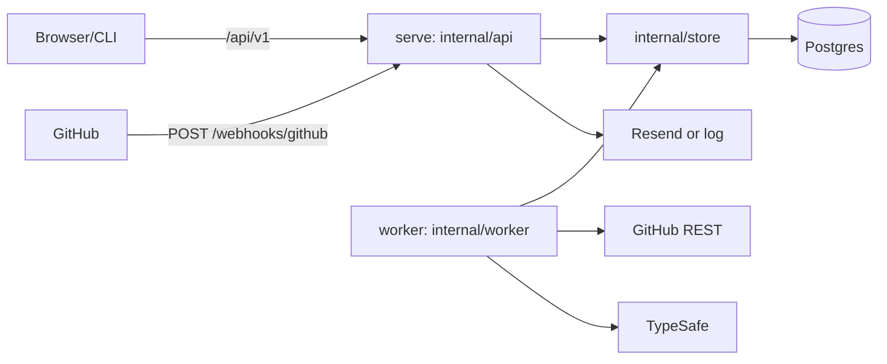

# api Blueprint

## System Overview
Go module `github.com/NarayanaSabari/velvet-otter-lab/api`. One binary, `ticket`, runs the HTTP API (`serve`), the background worker (`worker`), migrations (`migrate`) and a suggestion evaluator (`eval-suggestions`). Postgres is the only store. The API enqueues GitHub webhook deliveries as `job` rows and the worker drains them.

## Subdirectories & System Boundaries
- cmd: [./cmd/README.md](./cmd/README.md) - `ticket` entry point.
- internal: [./internal/README.md](./internal/README.md) - all application packages.

## Global Invariants
- Schema changes only through numbered files in `internal/db/migrations`.
- Jobs are at-least-once with a 5 minute lease and claim-generation fencing.
- Webhooks are trusted only with a valid HMAC signature.
- Authentication and request-origin rules follow the [HTTP API contract](./internal/api/README.md).
- `config.Config.ValidateServe` requires `RESEND_API_KEY` and `MAIL_FROM` for an HTTPS `BASE_URL`. Workers and migrations do not require mail settings.
- GitHub App settings are optional at configuration load time. An absent TypeSafe API key disables worker suggestions (`typesafe.New`).

## Global Side Effects
- Postgres via `DATABASE_URL`.
- GitHub REST and OAuth, Resend email, TypeSafe API.

## System Verification
- Run: `cd api && go test ./...` (needs Docker for Testcontainers)
