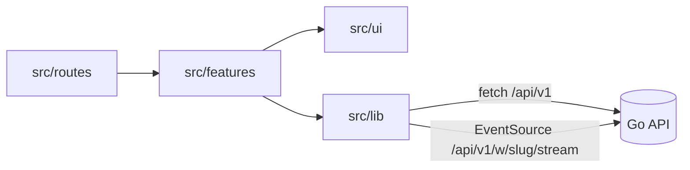

# React + TypeScript + Vite

This template provides a minimal setup to get React working in Vite with HMR and some Oxlint rules.

Currently, two official plugins are available:

- [@vitejs/plugin-react](https://github.com/vitejs/vite-plugin-react/blob/main/packages/plugin-react) uses [Oxc](https://oxc.rs)
- [@vitejs/plugin-react-swc](https://github.com/vitejs/vite-plugin-react/blob/main/packages/plugin-react-swc) uses [SWC](https://swc.rs/)

## React Compiler

The React Compiler is not enabled on this template because of its impact on dev & build performances. To add it, see [this documentation](https://react.dev/learn/react-compiler/installation).

## Expanding the Oxlint configuration

If you are developing a production application, we recommend enabling type-aware lint rules by installing `oxlint-tsgolint` and editing `.oxlintrc.json`:

```json
{
  "$schema": "./node_modules/oxlint/configuration_schema.json",
  "plugins": ["react", "typescript", "oxc"],
  "options": {
    "typeAware": true
  },
  "rules": {
    "react/rules-of-hooks": "error",
    "react/only-export-components": ["warn", { "allowConstantExport": true }]
  }
}
```

See the [Oxlint rules documentation](https://oxc.rs/docs/guide/usage/linter/rules) for the full list of rules and categories.

## Velvet web Blueprint

### System Overview
React 19 and TypeScript SPA built with Vite, Tailwind, TanStack Router, and TanStack Query. SPA data requests go to the Go API under `/api/v1` with a same-origin HttpOnly cookie session (`src/lib/api.ts`), and caches refresh from a per-workspace SSE stream (`src/lib/useStream.ts`). Separately, the SPA links to API-served pages such as GitHub connect, and `public/install.sh` downloads the CLI from a Velvet server.



### Local Interface & Invariants
- `npm run dev`: Vite on port 5173, proxies `/api` and `/webhooks` to `http://localhost:8080` (`vite.config.ts`).
- `npm run build`: `tsc -b` then `vite build` into `dist/`.
- `npm run test`: `vitest run` in jsdom.

### Subdirectories & System Boundaries
- src: [./src/README.md](./src/README.md) - application source (app, features, lib, routes, ui).
- public: [./public/README.md](./public/README.md) - static assets and the CLI installer script.

### Global Invariants
- The SPA never stores a session token. Requests use `credentials: 'same-origin'`.
- Server is source of truth. SSE events invalidate queries rather than patching them.
- UI rules live in the repository `design.md`.

### Global Side Effects
- HTTP calls to `/api/v1`, SSE subscription, full-page navigation for auth and GitHub linking.
- `localStorage` is used only by `src/features/onboarding/ConnectAgentCard.tsx` for its dismissal flag.
- Explicit copy actions write to the clipboard, including Mermaid source (`src/ui/MermaidDiagram.tsx`). Sprint view selection updates browser history with `replaceState` (`src/features/sprints/SprintBoard.tsx`). Routes and loaded detail pages update `document.title` (`src/routes/root.tsx`).

### System Verification
- Run: `cd web && npm run test`
